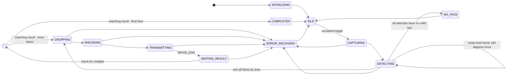
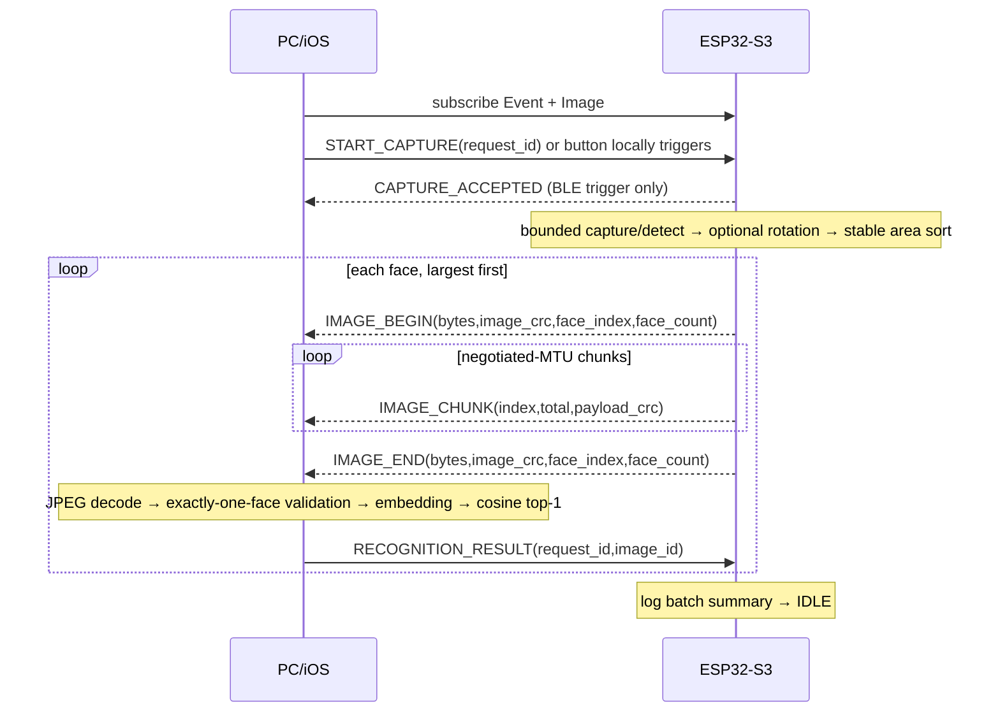

# BLE Application Protocol v2

`protocol/ble_protocol.yaml` is the normative single source of truth. Firmware, Python, and Swift constants are checked by `pc_client/tests/test_protocol_consistency.py`.

## GATT service

| Attribute | UUID | Properties | Permissions / purpose |
|---|---|---|---|
| Service | `7f510000-b7b2-4f6a-9f3a-6c8a2d7e1000` | primary | face demo service |
| Control | `7f510001-b7b2-4f6a-9f3a-6c8a2d7e1000` | Write, Write Without Response | client commands |
| Event | `7f510002-b7b2-4f6a-9f3a-6c8a2d7e1000` | Notify, Read | status/control events; read returns last bounded event |
| Image Data | `7f510003-b7b2-4f6a-9f3a-6c8a2d7e1000` | Notify | image chunks |
| Recognition Result | `7f510004-b7b2-4f6a-9f3a-6c8a2d7e1000` | Write | client result response |
| Device Information | `7f510005-b7b2-4f6a-9f3a-6c8a2d7e1000` | Read | protocol/firmware/model/build/max-image/features |
| SD Export Info | `7f510006-b7b2-4f6a-9f3a-6c8a2d7e1000` | Read | optional Wi-Fi export session JSON; GATT long read, at most 512 bytes |

Development mode permits unencrypted read/write. Production permission requirements are encrypted + authenticated writes for Control and Recognition Result, encrypted reads/notifies, bonding, and an application-authorized peer.

## Packet header

All integers and IEEE-754 `float32` values are **little-endian**. Strings are UTF-8 without NUL terminators. The fixed header is 32 bytes:

| Offset | Bytes | Field | Meaning |
|---:|---:|---|---|
| 0 | 4 | magic | `0x45434146`; bytes on wire spell `FACE` |
| 4 | 1 | protocol_version | `2` |
| 5 | 1 | message_type | table below |
| 6 | 2 | flags | message flags; `0x0001` is `FACE_SEQUENCE` |
| 8 | 4 | request_id | operation correlation |
| 12 | 4 | image_id | ESP32-generated image correlation |
| 16 | 4 | payload_length | bytes following header |
| 20 | 2 | chunk_index | zero-based for IMAGE_CHUNK |
| 22 | 2 | total_chunks | stable for all chunks |
| 24 | 4 | CRC32 | IEEE CRC32 of this packet payload |
| 28 | 4 | reserved | message-specific metadata; see face sequence and Phase 5 notes |

Maximum application image is 163,840 bytes. `person_id` is at most 32 UTF-8 bytes and name at most 64. Unknown fields are not appended in v2; future versions use a new major protocol version or optional-message flag.

| Code | Message | Direction / payload |
|---:|---|---|
| 1/2 | HELLO / HELLO_ACK | capability negotiation |
| 3 | START_CAPTURE | client→Control; `<command:u16,reserved:u16,timestamp_s:u32>` |
| 4 | CAPTURE_ACCEPTED | ESP→Event |
| 5 | BUSY | ESP→Event; requested ID in header, active image ID, current state in reserved |
| 6 | STATUS | ESP→Event |
| 7 | IMAGE_BEGIN | ESP→Event; `<image_bytes:u32,image_crc32:u32>` |
| 8 | IMAGE_CHUNK | ESP→Image Data; sequence fields + bytes |
| 9 | IMAGE_END | ESP→Event; repeats begin metadata and means application transfer complete |
| 10 | RECOGNITION_RESULT | client→Result; layout below |
| 11/12 | NO_FACE / ERROR | ESP→Event; ERROR payload begins with `error_code:u16` |
| 13/14 | PING / PONG | liveness |
| 15 | EVENT_OPEN | ESP→Event; Event ID and VAD trigger; associates header request ID |
| 16 | EVENT_AUDIO_READY | ESP→Event; audio terminal status and sample range; no audio bytes |
| 17 | FACE_BATCH_END | ESP→Event; explicit terminal face status and counters |
| 18 | EVENT_COMPLETE | ESP→Event; final Event/audio/face statuses |
| 19 | SD_EXPORT_START | client→Control; empty payload |
| 20 | SD_EXPORT_CANCEL | client→Control; `<session_id:u64>`; requires matching nonzero session |
| 21 | SD_EXPORT_GET_STATUS | client→Control; `<session_id:u64>`; zero queries latest session |
| 22 | SD_EXPORT_STATUS | ESP→Event; `<session_id:u64,state:u8,reserved:u8,error_code:u16,reserved:u32>` |

Recognition result fixed prefix is `status:u8, person_id_len:u8, name_len:u8, reserved:u8, similarity:f32, processing_time_ms:u32`, followed by optional UTF-8 ID and name. `person_id`, never the display name, is the stable identity key.

For a face JPEG, IMAGE_BEGIN and IMAGE_END set `FACE_SEQUENCE` and pack zero-based `face_index` into `reserved[15:0]` and `face_count` into `reserved[31:16]`. `face_count` must be nonzero, `face_index < face_count`, and both packets must carry identical sequence metadata. IMAGE_CHUNK remains correlated by request/image IDs and does not repeat the face metadata. An image without `FACE_SEQUENCE` is interpreted as face 0 of 1. These layouts and the recognition-result payload are unchanged from v1.

## Event 1 association payloads

Every Event message has zero image ID, flags, chunk fields and header reserved. Its header request ID is the associated face request, or zero when no request was accepted. Zero never forms a global request mapping. All reserved payload bytes are zero. The wire layouts are:

| Message | Bytes | Python struct | Fields in order |
|---|---:|---|---|
| EVENT_OPEN | 16 | `<QB7x` | event_id:u64, trigger_type:u8, reserved[7] |
| EVENT_AUDIO_READY | 32 | `<QB7xQQ` | event_id:u64, audio_status:u8, reserved[7], first_sample:u64, last_sample:u64 |
| FACE_BATCH_END | 32 | `<QIHHHHHB9x` | event_id:u64, request_id:u32, expected:u16, completed:u16, recognized:u16, unknown:u16, failed:u16, face_status:u8, reserved[9] |
| EVENT_COMPLETE | 16 | `<QBBB5x` | event_id:u64, event_status:u8, audio_status:u8, face_status:u8, reserved[5] |

FACE_BATCH_END's status is at byte 22; nine reserved bytes make its payload 32 bytes. `completed = recognized + unknown + failed`, and `completed <= expected`. UNKNOWN is a completed face association. Trigger source Event1/VAD is 3. Audio statuses are PENDING=0, READY=1, FAILED=2. Face statuses are PENDING=0, COMPLETED=1, NO_FACE=2, PARTIAL=3, BUSY=4, TIMEOUT=5, DISCONNECTED=6, FAILED=7. Event statuses are COMPLETE=0 and COMPLETE_WITH_ERROR=1. COMPLETE requires READY audio plus COMPLETED or NO_FACE; every other terminal combination uses COMPLETE_WITH_ERROR.

`event_id = boot_session_id << 32 | event_sequence`. The PC and SD represent it as 16 uppercase hex digits, including leading zeros. Request/image ownership is scoped to the boot session because counters restart on reboot. EVENT_OPEN must precede images; audio/face terminal messages may arrive before OPEN and create a durable shell record. Identical OPEN/terminal retransmissions are idempotent; conflicting ownership or terminal contents are rejected. EVENT_COMPLETE requires both branch terminals. A BLE disconnect preserves received faces and recognition results, marks pending faces DISCONNECTED locally, and leaves pending audio and Event completion pending until authoritative device metadata is available.

Disconnect/reconnect clears active request/image mappings and the inferred boot session. Images arriving before the new connection receives an Event message remain manual captures; they cannot inherit a previous connection's Event ownership. Durable old Event rows remain available for inspection, and an old recognizer cannot write its result to a newly reused request ID.

The PC maintains a separate `EventStore` SQLite file (`event_store.db` by default), with `events` and `event_faces`. It persists recognition before attempting the BLE response, including UNKNOWN and FAILED. `result_sent` distinguishes results saved locally from successful BLE writes. READY audio supplies the expected SD filename `event_<EVENT_ID>.wav`; Event messages do not carry that WAV. The optional Wi-Fi SD export below transfers on-card files. Set the database path with `python -m pc_client --event-database events.db run --wait-only`, or pass `event_store=` / `event_database=` to `BleFaceSession`.

## BLE-initiated Wi-Fi SD export

The integrated `event1_audio_face` app advertises feature `WIFI_SD_EXPORT=0x00000040` in Device Information when its export service is installed. Other phase apps do not advertise this feature. Read capabilities before offering export; `HELLO`/`HELLO_ACK` are reserved message types rather than an implemented capability handshake. The SD Export Info characteristic is appended to the existing GATT table, preserving the original UUIDs and ordering.

Subscribe to Event, then send `SD_EXPORT_START` with a fresh nonzero client request ID (bit 31 clear). Export uses a separate nonzero 64-bit session ID, unrelated to Event IDs. All export command/status headers have zero image ID, flags, chunk fields and reserved. START is exactly zero payload bytes; CANCEL and GET_STATUS are exactly eight little-endian bytes. No extra command prefix is included.

`SD_EXPORT_STATUS` is exactly 16 payload bytes (`<QBBHI`): session ID at offset 0, state at 8, zero reserved byte at 9, error code at 10, and four zero reserved bytes at 12. States are IDLE=0, PREPARING=1, READY=2, TRANSFERRING=3, RESTORING=4, COMPLETED=5, CANCELLED=6, FAILED=7. An idle response before any session may carry session ID zero. A status reply echoes the command request ID; asynchronous state updates correlate with the initiating request. GET_STATUS replays current or retained terminal state; an unknown nonzero session fails with INVALID_SESSION. All export notifications fit ATT MTU 67 without fragmentation. Event subscription and MTU 67 are required before START.

PREPARING closes admission to new VAD Events and diagnostic captures. Existing recording/capture work may finish, then pending metadata is drained and SD writers close before the read-only snapshot becomes READY. Preparation is bounded to 30 seconds; timeout restores normal admission without forcibly truncating the active work. Recording/captures remain paused while the snapshot is served. Export recursively includes every regular SD file, including unrelated files, and preserves relative paths; empty directories have no file record. Unsupported paths or any traversal/read failure fail the export rather than silently omitting data. Export never deletes SD data.

The current path limits are 1024 UTF-8 bytes per relative path, 16 directory levels, and 255 UTF-8 bytes per filename (the pinned FatFS filename-output buffer). Unsupported long-name fallback is an export error, not permission to rename files to their short alias. Native FatFS reads and unsigned file sizes support FAT32 files above 2 GiB up to the filesystem's per-file limit; protocol totals and Range arithmetic use unsigned 64-bit values.

After READY, read SD Export Info with CoreBluetooth `readValue(for:)`. Its UTF-8 JSON value is immutable for the session and at most 512 bytes; GATT Read Blob handles values exceeding one ATT packet. Firmware returns the complete cached value to NimBLE on each read, which applies the offset. No BLE packet header wraps this JSON:

```json
{"format_version":1,"session_id":"0000000100000001","ssid":"EventPipe-example","passphrase":"example-only-passphrase","base_url":"http://192.168.4.1","token":"example-only-replace-with-session-token"}
```

The session ID uses 16 uppercase hexadecimal digits. Credentials are generated anew for each session and are not persisted as Wi-Fi provisioning. iOS joins the ESP32 WPA2 SoftAP using `NEHotspotConfiguration`, with user consent, and downloads from the supplied local endpoint. Keep credentials in memory and send the token only as `Authorization: Bearer <token>` on every export route. The development BLE security policy above also applies to this credential read. See [iOS integration](IOS_SD_EXPORT.md) for the reusable Swift client, entitlements, privacy keys and example, and [Event data model](EVENT_DATA_MODEL.md) for importing WAV/CSV content.

| HTTP operation | Contract |
|---|---|
| `GET /v1/export/status` | Authenticated session status and keep-alive |
| `GET /v1/export/manifest` | Stream UTF-8 NDJSON header, optional progress, file records, then end record |
| `GET /v1/export/file?path=<percent-encoded-relative-UTF8-path>` | Raw file bytes; supports a single byte Range and If-Range |
| `POST /v1/export/complete` | Acknowledge verified snapshot using `session_id`, `manifest_sha256`, `file_count`, `total_bytes` |

The manifest header carries `type:"header"`, `format_version:1` and `session_id`. Each file line contains `type:"file"`, `path`, byte `size`, lowercase hexadecimal `sha256` and a quoted `etag`. Paths are relative to the SD root with `/` separators. The end line contains `type:"end"`, `file_count`, `total_bytes` and `manifest_sha256`. Compute the manifest SHA-256 over **the exact UTF-8 file-record lines including each LF**, excluding header/progress/end; do not parse and reserialize before hashing. A manifest is valid only when its end record is received and count/size/digest agree. Progress records keep long scans observable and are excluded from the digest.

Download each file sequentially into a temporary local file, validate size and SHA-256, then commit it to the app's export directory. Retrying a file within the same session uses Range plus the manifest ETag; a changed ETag requires restarting that file. An offset equal to file size is already complete locally and should be verified without issuing an invalid range. The client posts completion only after all files pass validation. The server sends its completion response before shutting down HTTP/Wi-Fi and restoring audio/capture admission; COMPLETED means restoration succeeded, while restoration failure reports AUDIO_RESUME_FAILED. User cancellation or lease expiry also restores normal operation.

The idle lease is 120 seconds; actual scanning/hash work and transfer progress keep it alive. BLE loss alone does not cancel a valid HTTP session. Reconnect, rediscover and use GET_STATUS to recover state. Export status notifications belong to the BLE connection that issued an export command; a replacement legacy client receives no unsolicited new message types. A restarted device invalidates the old session and credentials. CANCEL must match the active nonzero session. Treat HTTP/SD errors, missing manifest end, wrong session and checksum mismatch as incomplete export; never report success based only on a completed HTTP connection.

New export errors are SD_UNAVAILABLE=23, EXPORT_BUSY=24, QUIESCE_TIMEOUT=25, WIFI_START_FAILED=26, SD_IO=27, INVALID_SESSION=28, AUDIO_RESUME_FAILED=29, PATH_UNSUPPORTED=30 and EXPORT_EXPIRED=31. Existing image/recognition error codes remain unchanged.

## IDs and ordering

Client request IDs are nonzero and bit 31 is clear. External-button and Event 1 request IDs are generated by the ESP32 with bit 31 set. Reuse within the firmware's recent-ID window is rejected. Every face in an accepted request receives a unique ESP32-generated `image_id`; all faces retain the request ID. A result must match the currently active request/image IDs; stale or wrong results are ignored and reported.

Exactly one request may be active. Its configured face-detection recaptures keep the first image ID, and its sorted faces are transferred one at a time while the request remains BUSY. A trigger during any state other than IDLE receives BUSY and is not queued. The original camera frame is retained until every face has been copied; the crop and JPEG slots are reused per face. The JPEG slot is reclaimed after IMAGE_END before waiting for that face's recognition result. A timeout, disconnect, or pipeline failure aborts the remaining faces.

## MTU, chunks, CRC, and timing

The peripheral prefers MTU 517 but never assumes it. ATT notification value capacity is `MTU - 3`. IMAGE_CHUNK byte capacity is therefore:

```text
chunk_payload = negotiated_MTU - 3 - 32
```

MTU must be at least 36 for the header plus one payload byte. A smaller MTU is a protocol error. The PC validates per-chunk CRC, request/image IDs, stable total count, duplicates, missing and out-of-order sequences. Duplicates with identical bytes are counted; conflicting duplicates fail. IMAGE_END additionally validates whole-image byte count and CRC32.

Event 1 requires ATT MTU **67** for its largest notification (`32-byte header + 32-byte payload + 3-byte ATT overhead`). Event messages are never truncated or fragmented into image chunks. A smaller MTU can prevent Event publication; local audio/SD ownership still remains intact.

Each capture has a 4 s bounded wait (in pinned esp32-camera 2.1.7) and each detection invocation has a 6 s policy. The default no-face fallback is one initial capture plus two recaptures, followed by one 180-degree detection of the final frame; therefore it permits at most three captures and four detector invocations before `NO_FACE`. Encoding is 3 s, image transfer/reassembly 15 s, and recognition response 15 s. BLE notification allocation and queue congestion use 5 ms backpressure retries for at most 500 ms per notification. RSSI is sampled no more than once per second.

## State and timing diagrams





## Disconnect/reconnect and errors

On disconnect, the ESP32 stops sending, counts failure/disconnect, releases image ownership in controller recovery, and resumes advertising. The client reconnects, discovers characteristics, and resubscribes; partial images are discarded, never resumed. A fresh request ID is required. Peer-not-subscribed and insufficient-MTU failures are reported without taking another photo.

Error codes 0–31 are defined in YAML. Codes 0–22 cover image/recognition transport; codes 23–31 cover the optional SD export described above.

Sample PING request (`request_id=1`, empty payload):

```text
46 41 43 45 02 0D 00 00 01 00 00 00 00 00 00 00
00 00 00 00 00 00 00 00 00 00 00 00 00 00 00 00
```

PC flow uses Bleak scan/connect/discover, subscribes Event and Image, optionally writes START_CAPTURE, reassembles and validates JPEG, runs InsightFace, then writes result. iOS follows the same sequence with `CBCentralManager`, `CBPeripheral`, `.withResponse` Control/Result writes, notify subscriptions, `maximumWriteValueLength`/negotiated notification behavior, and `BLEProtocol.swift` packet validation. No iOS UI is included.

Backward compatibility: v1 peers reject v2 as an unsupported major version; v2 peers reject v1. Upgrade firmware and client together. The 32-byte header offsets, existing message IDs 1–14, UUIDs, image/recognition payloads and FACE_SEQUENCE packing are preserved. v2 clients interpret an unflagged image as face 0 of 1. The host suite checks the normative YAML against Python/C++/Swift constants and compiles the C++ serializers to compare complete golden packets against Python.

The SD export extension keeps protocol version 2 and message IDs 1–18 intact. Older v2 clients reject unknown message IDs, so firmware emits 19–22 traffic only in response to export commands on that BLE connection. The new read characteristic does not require old clients to use it. iOS should rediscover on reconnect and handle `peripheral(_:didModifyServices:)`; include upgrades from a previously connected firmware version in hardware testing because GATT caches can outlive one connection.
