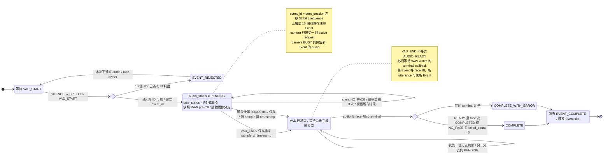
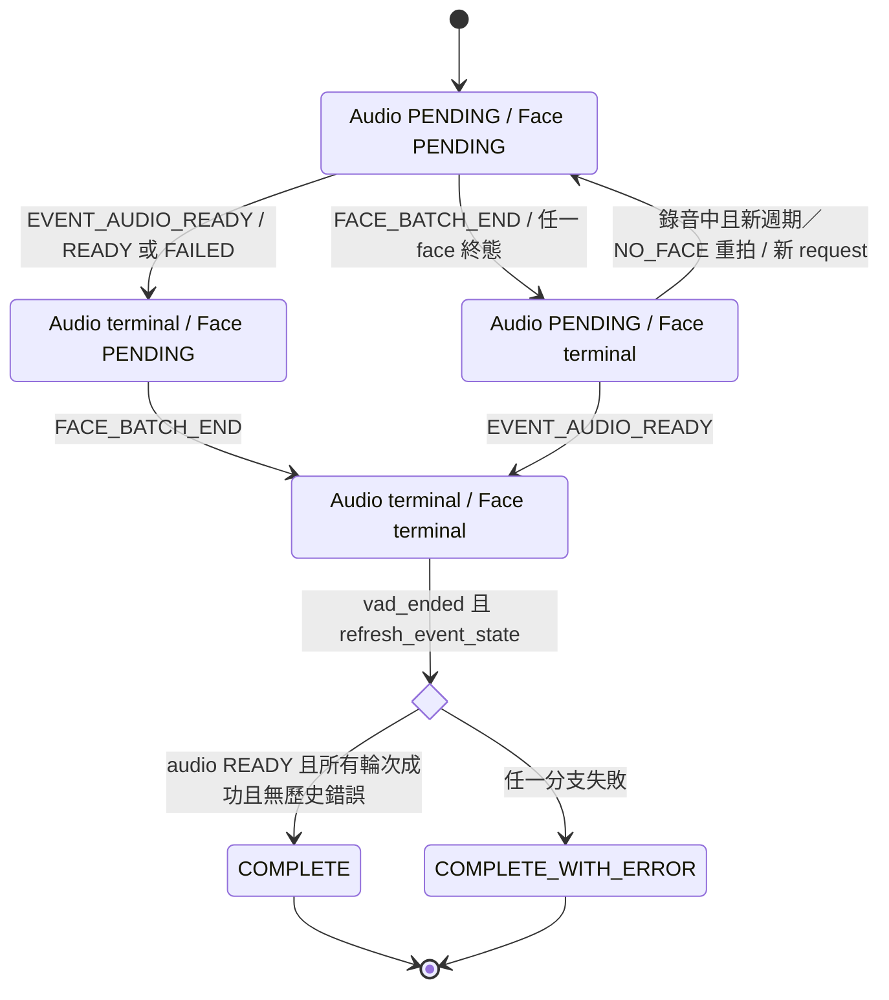
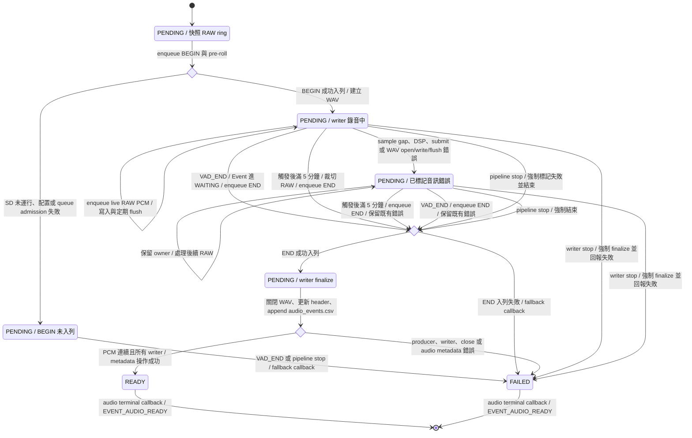
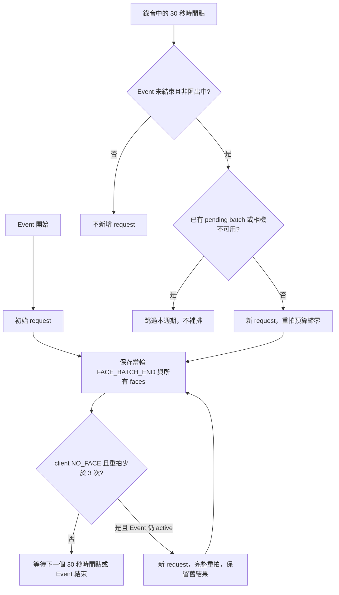
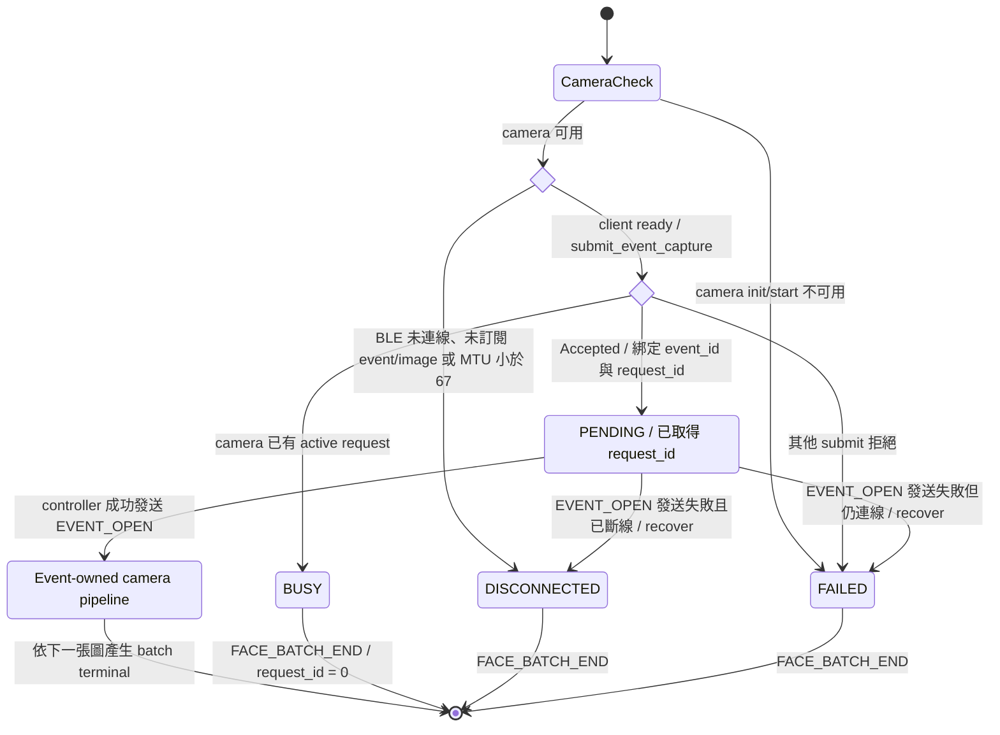
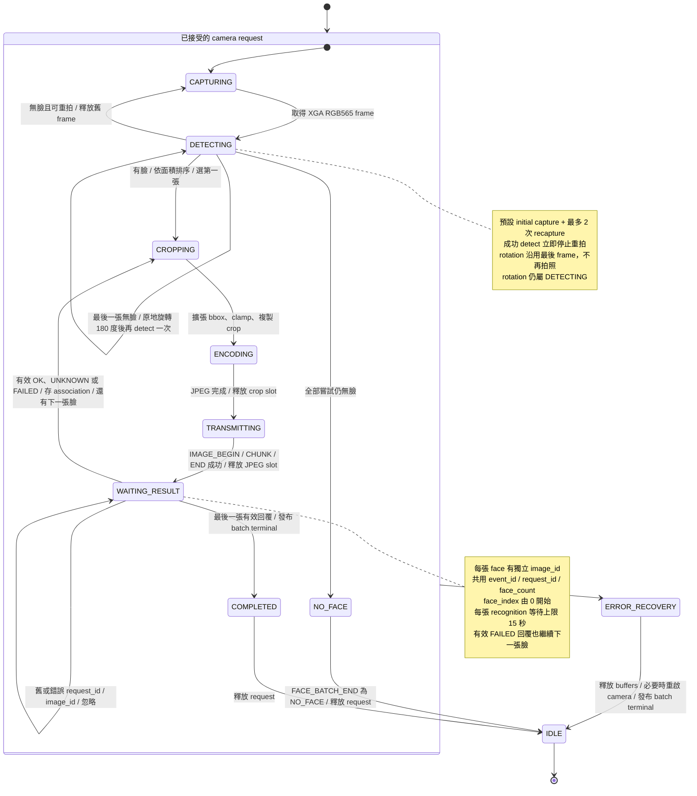
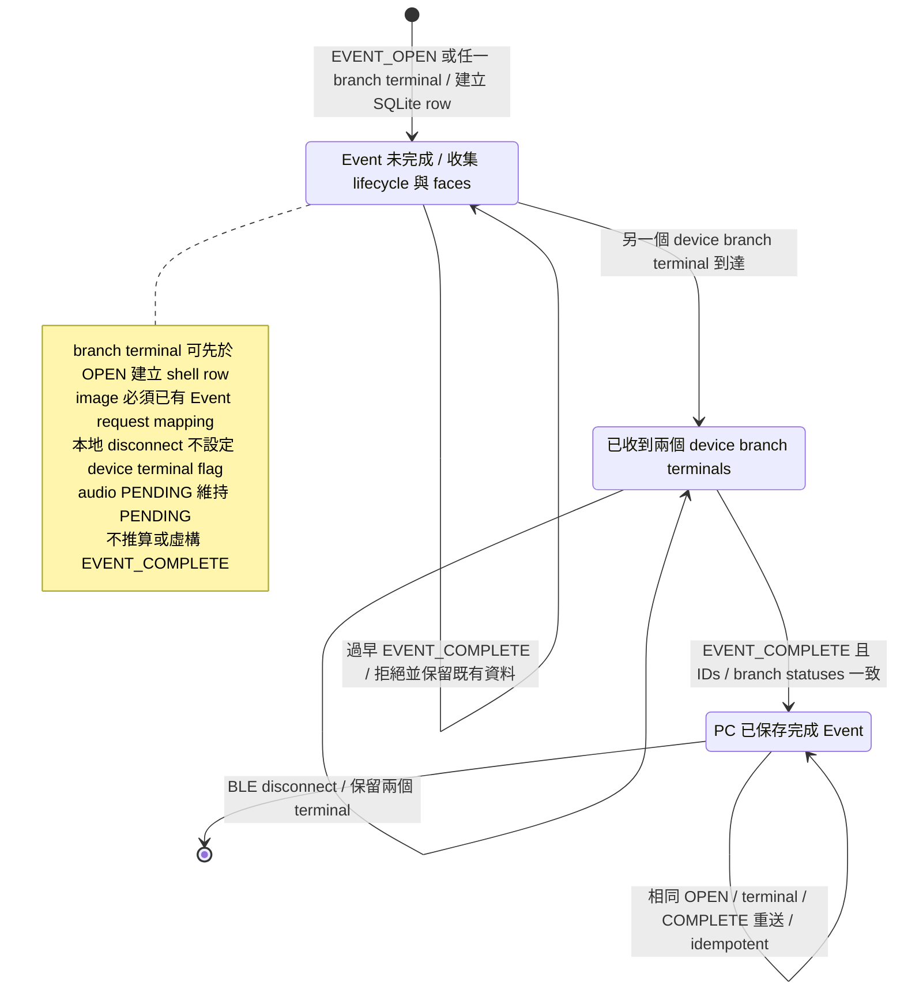

# Event 1 State Diagram

本文件依目前 `event1_audio_face`、`EventManager`、audio recorder、camera pipeline 與 PC `EventStore` 的實作繪製。**一次 VAD utterance = 一個 Event**；同一個 `event_id` 擁有一條 audio 分支，以及多個包含 N 張臉的 camera request（開始、每 30 秒及 NO_FACE 重拍）。兩條分支非同步執行，終態可以以任意順序到達。

圖中的 `OPEN / WAITING / COMPLETE / COMPLETE_WITH_ERROR` 是實際 `EventState`；audio 的 `PENDING / READY / FAILED` 和 face batch 的狀態則分別保存在 `AudioStatus`、`FaceBatchStatus`。其餘中文節點是操作步驟或判斷，用來展開流程，不是新增的 firmware enum。

## 1. Event 主狀態機

正常 audio terminal 在 VAD_END 後到達，因此經過 `WAITING`。`refresh_event_state()` 現在要求 `vad_ended`、audio terminal 及最後一輪 face terminal；錄音中的任何單輪結束不會完成 Event。`WAITING` 是 utterance 已結束的意思，不代表已有任一分支完成。

Audio 最長為 VAD 觸發後 5 分鐘，pre-roll 另計。到上限時由 RAW sample clock 觸發既有 end callback 與 recorder END，最後一個 frame 會裁切至上限，不因正常到上限而標記失敗。此時保存的 `vad_end_sample`／timestamp 表示強制結束邊界；log 以 `reason,max_duration` 區分。收尾後等待 VAD 回到非語音，再收到下一次語音轉換才可建立新 Event，不重設 VAD、不立即續開。

啟動前，app 必須成功初始化 NVS boot counter、EventManager 與 audio pipeline 才能接收 VAD Event。NVS 初始化／commit／counter overflow、EventManager task 或 audio init/start 失敗會停止 Event 啟動；camera/BLE init/start 失敗則允許 audio 繼續，每個 Event 的 face 分支直接回報 `FAILED`。

## 2. Audio / Face 的非同步完成匯合

以下節點表示兩個 status 欄位的組合，與前面的 `EventState` 同時存在。

| 欄位 | 非終態 | 終態 | 對 Event 的影響 |
|---|---|---|---|
| Audio | `PENDING` | `READY`、`FAILED` | `FAILED` 仍需等待 face terminal |
| Face batch | `PENDING` | `COMPLETED`、`NO_FACE`、`PARTIAL`、`BUSY`、`TIMEOUT`、`DISCONNECTED`、`FAILED` | 任一終態仍需等待 audio terminal |
| Event | `OPEN`、`WAITING` | `COMPLETE`、`COMPLETE_WITH_ERROR` | 發布完成資訊後才釋放 Event slot |

`UNKNOWN` 是有效且已完成的單臉 recognition result，不會單獨造成 Event error。`NO_FACE` 是 ESP 未偵測到臉的成功 batch 終態；所有輪次皆成功且 audio 為 `READY` 時可得到 `COMPLETE`。手機回覆的單臉 CLIENT_NO_FACE 則計入 failed 並觸發有限重拍。單臉 `FAILED` 也計入 `completed_faces`，但會使 batch／Event 帶有錯誤。

## 3. Audio 分支：RAW pre-roll → WAV → terminal

WAV 保存 **pre-DSP RAW PDM capture，16 kHz / mono / PCM16**，路徑為 `/sd/event_<16HEX>.wav`。pre-roll 預設要求 1,000 ms，ring 容量為 2,000 ms；快照包含 VAD 延遲期間已捕捉的 RAW 資料，冷啟動只保存實際可用的資料。

`audio_last_sample` 是實際保存資料的 exclusive boundary，可晚於 `vad_end_sample`。writer 的早期 open/write 錯誤先保留在結果中，到 END 或強制 finalize 才回報 terminal。BEGIN／END 入列失敗走 pipeline fallback；此時不能保證 WAV 或 SD metadata 完整。Audio 失敗不會取消 camera ownership。

`EVENT_AUDIO_READY` 是 terminal 訊息名稱，payload 可以是 `READY` **或 `FAILED`**，不包含 audio bytes。

## 4. Face 分支：request admission

下方 admission 圖套用於初始輪；後續週期的 BUSY／不可用直接跳過，不產生 request-0 假輪次。NO_FACE 重拍等待相機可用，但 VAD_END、5 分鐘上限或匯出 gate 後不再新增 Event request。任何早期輪次失敗仍使最終 Event 為 COMPLETE_WITH_ERROR；最後一輪成功不會清除歷史。

未接受 camera request 時，`request_id = 0`，仍發布 Event lifecycle 並繼續錄音。`BUSY` 結束初始輪的 face 分支；後續 30 秒輪次仍可嘗試，忙碌的週期不補排。GPIO／BLE manual capture 共用 camera arbitration，但不建立 audio Event。

controller 必須在 Event-owned camera work 前成功發送 `EVENT_OPEN`，讓 PC 先建立 association。EventManager 也會發布相同的 OPEN；PC 以 idempotent 方式接受相同內容。

## 5. Camera / 多人臉 pipeline

此圖使用實際 `SystemState` 名稱。整個 composite 的錯誤出口涵蓋 capture、detect、rotation、bbox、crop、JPEG、BLE transfer 與 recognition validation 的失敗。

`SystemState::COMPLETED` 表示這個 camera loop 已處理完全部回覆，並不保證 `FaceBatchStatus` 是 `COMPLETED`。實際 batch terminal 判斷如下；`completed = recognized + unknown + failed`。

| 結束原因 | 條件／優先順序 | FaceBatchStatus |
|---|---|---|
| 所有 capture／fallback 都無臉 | expected = completed = 0 | `NO_FACE` |
| 全部 N 張有效回覆 | failed = 0，允許 UNKNOWN | `COMPLETED` |
| 全部 N 張有效回覆 | failed > 0，且 recognized + unknown > 0 | `PARTIAL` |
| 全部 N 張有效回覆 | 所有回覆皆 FAILED | `FAILED` |
| Pipeline 中途失敗 | **先判斷** completed > 0；包含先前有效 FAILED 回覆 | `PARTIAL` |
| Pipeline 中途失敗 | completed = 0，原因為 disconnect | `DISCONNECTED` |
| Pipeline 中途失敗 | completed = 0，原因為 image／recognition timeout | `TIMEOUT` |
| Pipeline 中途失敗 | completed = 0，其他錯誤 | `FAILED` |

Pipeline error 會停止剩餘 faces，保留所有已返回的 association，回 `IDLE` 接收其他 request。camera 完成不會等待 WAV；EventManager 仍保存這個 Event，直到 audio 也 terminal。

## 6. PC EventStore：接收終態與保存結果

PC 沒有 firmware 的 `OPEN / WAITING` enum；以下是依 terminal flags 與 `completed_at` 展開的接收狀態。

PC 會拒絕 conflicting duplicate、跨 Event／boot-session 的 ownership、stale image／recognition，以及與既有終態不一致的 COMPLETE。斷線觀察只把尚未收到 device face terminal 的 face status 標成 `DISCONNECTED`；所有既有 faces／recognition 保留，未完成 Event 等待真實 device terminal。重連不自動重播錯過的 lifecycle；SD／structured logs 是缺失 Event 的追查依據。

## 7. 狀態、訊息與保存位置

| 發生點 | BLE lifecycle | SD／PC 保存 |
|---|---|---|
| 接受 VAD Event／face request mapping | `EVENT_OPEN` | SD lifecycle OPEN／FACE_BATCH_OPEN；PC `events` 與 `event_batches` |
| 單張有效 recognition 回覆 | PC → ESP `RECOGNITION_RESULT` | SD `face_associations.csv`；PC `event_faces`，另追蹤 `result_sent` |
| Audio terminal | `EVENT_AUDIO_READY`，status 為 READY 或 FAILED | WAV、`audio_events.csv`、lifecycle AUDIO_READY；PC audio status／sample boundaries |
| Face batch terminal | `FACE_BATCH_END` | face associations 的 terminal sentinel 與 lifecycle FACE_BATCH_END；PC `event_batches` 各輪 status／counts |
| Audio + Face 都 terminal | `EVENT_COMPLETE`，含最終 Event／audio／face status | lifecycle COMPLETE；PC `event_status` 與 `completed_at` |

Face terminal sentinel 的 `image_id = 0`、`face_index = -1`，不是一張臉。BLE lifecycle 發送失敗會記錄 protocol failure，但不阻止本地 Event 狀態完成與 slot 釋放；SD metadata 入列／寫入失敗也會另外計數與記錄，不能假設每次完成都留下完整的外部證據。

## 實作對照

- [EventState、terminal validation 與完成判斷](../firmware/components/pipeline_core/include/event_types.hpp)：`apply_vad_end()`、`apply_audio_terminal()`、`apply_face_terminal()`、`refresh_event_state()`。
- [Event ID、16-slot admission 與 release](../firmware/components/event_manager/include/event_ledger.hpp)：`EventLedger::open()`、`release()`。
- [EventManager callbacks、分支 admission 與 publication](../firmware/components/event_manager/event_manager.cpp)：`on_open()`、`on_end()`、`run()`、`publish_complete()`。
- [VAD 邊緣](../firmware/components/vad/vad_service.c)：`vad_service_on_afe_result()`。
- [Audio pre-roll、BEGIN／END 與 fallback](../firmware/components/audio_pipeline/audio_pipeline.c)：`vad_event()`、`end_event()`、`pipeline_task()`。
- [WAV writer 與 audio terminal](../firmware/components/recorder/sd_recorder.c)：`recorder_task()`、`finish_event()`。
- [Camera loop、recognition 與 recovery](../firmware/components/system_controller/system_controller.cpp)：`pipeline_task()`、`await_result()`、`recover()`。
- [Camera arbitration](../firmware/components/trigger_service/trigger_service.cpp)：`submit()`、`submit_event()`、`complete()`。
- [PC durable lifecycle](../pc_client/src/pc_client/event_store.py)：`audio_ready()`、`face_batch_end()`、`complete_event()`、`mark_disconnected()`。
- [Event 1 架構與操作](EVENT1.md)、[BLE wire layouts](BLE_PROTOCOL.md)。
